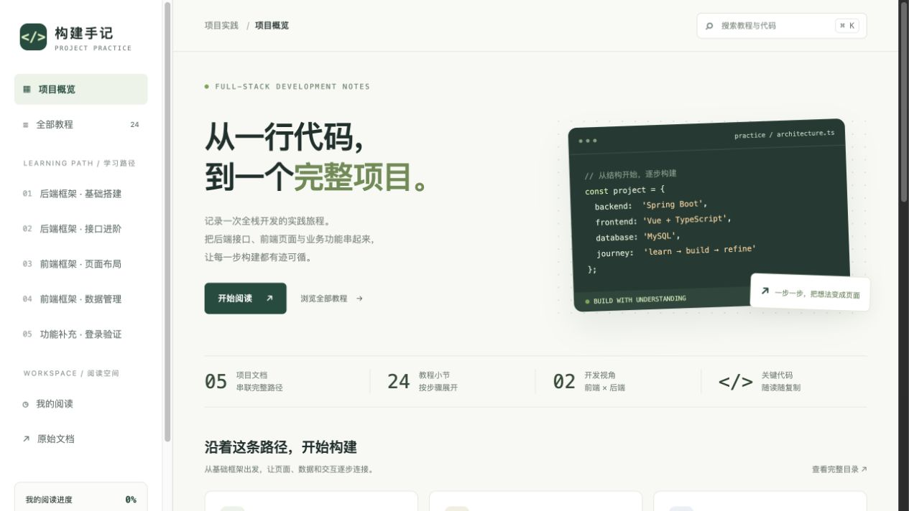

# 构建手记 · 全栈项目实践

从一行代码，到一个完整项目。

将五份原创项目实践文档整理成一个可浏览、可搜索的中文教程网站，串联 Spring Boot 后端、Vue 前端、管理员管理与登录验证的学习路径。

**5 个章节 · 24 个小节 · 无构建依赖 · MIT 开源**



## 项目介绍

这是一个全栈开发教程与学习成果展示网站。网站围绕管理员管理项目，将框架搭建、接口设计、页面布局和业务联调整理为操作步骤、关键代码与检查要点。

本仓库运行的是教程阅读站；文中的 Spring Boot / Vue 片段用于讲解，不是完整的管理员业务系统工程。内容经过重新编排和提炼，保留原始文档入口，并标明整理示例与补充说明。

## 功能

- **章节导航**：5 章、24 节，支持直接链接到某个小节。
- **全文检索**：搜索标题、步骤、技术标签与代码；支持 `Ctrl / ⌘ + K`。
- **代码复制**：一键复制代码；剪贴板不可用时可手动复制选中内容。
- **阅读进度**：手动标记已读，使用浏览器 `localStorage` 保存。
- **记录导出**：导出 Markdown 阅读清单，留出个人学习笔记位置。
- **请求流程演示**：查看 Vue → Axios → Spring Boot → MySQL 的职责。
- **响应式布局**：适配电脑、平板及手机，支持键盘导航和章节打印。

不需要注册或登录，不依赖第三方字体、脚本、图片 CDN 或分析服务。阅读进度只保存在当前浏览器，不会同步到服务器。

## 快速开始

需要 Python 3；不需要 Node.js 或 npm 安装步骤。

```bash
# 在解压后的项目根目录运行
python3 -m http.server 8080 --directory dist
```

浏览器打开 <http://localhost:8080>。Windows 环境也可以使用 `py -m http.server 8080 --directory dist`。

也可以通过任意静态文件服务器提供 `dist` 目录。

## 教程目录

| 章节 | 主题 | 核心内容 |
| --- | --- | --- |
| 01 | 后端框架 · 基础搭建 | 环境准备、测试接口、数据库、分层结构、Knife4j |
| 02 | 后端框架 · 接口进阶 | 统一响应、分页与模糊查询、业务异常、全局异常处理 |
| 03 | 前端框架 · 页面布局 | Vue 项目、路由、Element Plus、公共布局、窗口适配 |
| 04 | 前端框架 · 数据管理 | Axios、列表渲染、查询、表单、排序、批量删除 |
| 05 | 功能补充 · 登录验证 | 登录页面、验证码、账号校验、联调与会话边界 |

## 文件结构

```text
.
├── dist/
│   ├── index.html     # 页面入口
│   ├── styles.css     # 布局、响应式样式与打印样式
│   ├── content.js     # 章节内容、代码示例和原文链接
│   └── app.js         # 路由、搜索、复制、进度与导出
├── docs/
│   ├── desktop-preview.jpg
│   └── mobile-preview.jpg
├── .gitignore
├── LICENSE
└── README.md
```

## 修改内容

`dist/content.js` 定义 `window.CHAPTERS`。每章包含 `id`、`number`、`title`、`subtitle`、`source`、`tags` 和 `sections`；每节包含标题、介绍、步骤、代码、阅读提示和检查项。

修改现有小节时保留其 `id`，可继续使用已有直达链接和阅读标记。新增章节时，还需更新 `app.js` 中的章节短标题与图标映射。修改静态资源后，更新 `index.html` 中的资源版本参数，避免浏览器缓存旧文件。

## 静态部署

本仓库使用 GitHub Actions 自动发布 `dist` 目录到 GitHub Pages。向 `main` 推送网站文件变更后，会自动更新线上网站；也可以在 Actions 中手动运行 `Publish tutorial website`。

将 `dist` 目录中的文件上传到静态网站托管平台，并让 `index.html` 位于站点根目录。网站采用 Hash 路由，不需要后端接口或 SPA 路由回退配置。

在线浏览：[构建手记 · 全栈项目实践](https://doublett523.github.io/project-practice-atlas/)。网站已开放公开访问，可直接分享链接。

## 原始文档

以下原创文档构成本教程的内容来源：

1. [项目实践-I-I（后端框架）](https://docs.qq.com/doc/DYk51UU9QYmpLT1JL)
2. [项目实践-I-II（后端框架）](https://docs.qq.com/doc/DYnJSSXBqTE9KQW9E)
3. [项目实践-II-I（前端框架）](https://docs.qq.com/doc/DYkpyekZnQ3RwbFVv)
4. [项目实践-II-II（前端框架）](https://docs.qq.com/doc/DYmVHUHNoY2xYWEJT)
5. [项目实践-总体功能补充](https://docs.qq.com/doc/DYnZFZXdSQU13Q0Zm)

## 验证记录

已检查 JavaScript 语法与章节结构，并在浏览器验证搜索跳转、代码复制、阅读标记及刷新持久化、Markdown 导出、请求流程切换、手机导航和响应式布局。

课程代码是讲解片段，未作为完整 Spring Boot / Vue 工程进行编译或集成测试。

## 贡献与许可

欢迎通过 Issue 提交勘误、使用问题或改进建议，也欢迎提交 Pull Request。修改教程时请注明对应章节，并说明调整理由；界面改动请附上预览截图。

作者：[doublett523](https://github.com/doublett523)。网站整理与实现使用了 AI 辅助。

本仓库中的网站代码与收录的教程内容采用 [MIT License](LICENSE)。使用、修改或分发时，请保留许可证与版权声明。
